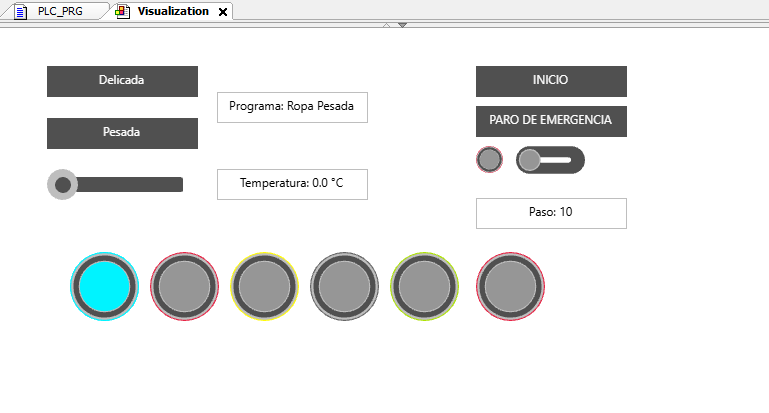
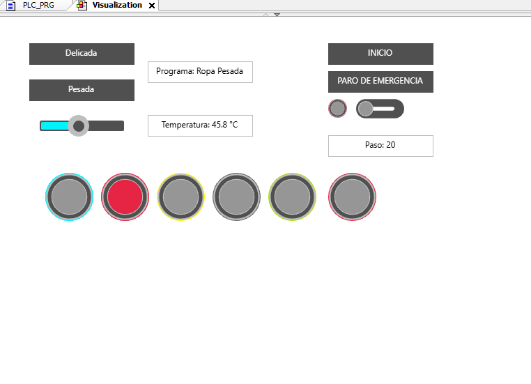
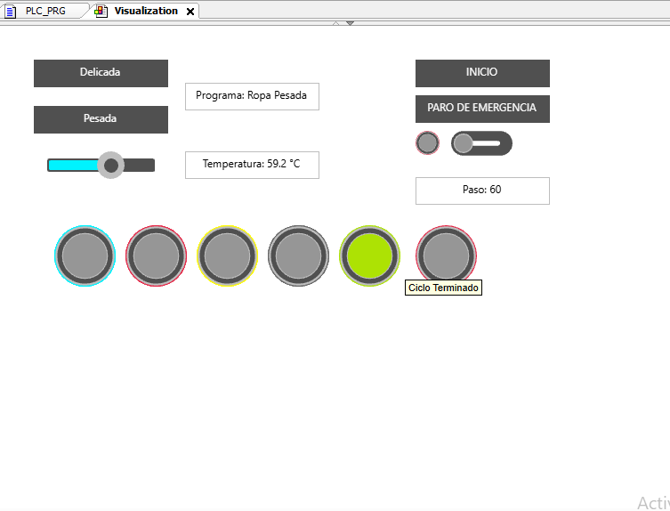
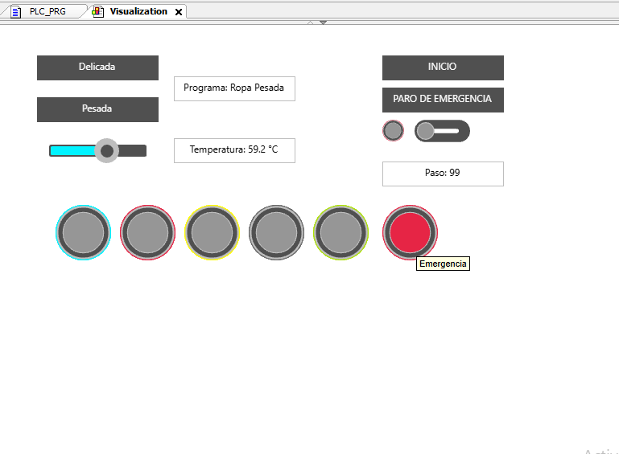

# Sistema de Control para Lavadora Industrial Programable (IEC 61131-3 / ST)

## Descripción del Proyecto
Control secuencial y analógico para una lavadora industrial desarrollado en **CODESYS V3.5 (SP22)** utilizando **Texto Estructurado (ST)** y programación modular orientada a objetos industriales (**`STRUCT`**, **`FUNCTION`** y **`FUNCTION_BLOCK`**).

El sistema gestiona recetas de lavado configurables, escalamiento de sensores analógicos de temperatura, control de motor con inversión de giro y enclavamientos de seguridad ante fallas térmicas.

---

## Arquitectura Modular

* **Gestión de Recetas (`ST_RecetaLavado` / `ARRAY`):** Almacena perfiles preconfigurados (*Delicado*, *Normal*, *Pesado*) con temperatura objetivo (`°C`), tiempo de lavado y velocidad de centrifugado.
* **Escalamiento Analógico (`FC_Escalar`):** Función reutilizable que convierte señales crudas de tarjeta analógica (`0` a `27648`) a unidades de ingeniería reales (`0.0 °C` a `100.0 °C`).
* **Control de Tambor (`FB_MotorTambor`):** Bloque de función encapsulado que gestiona arranque, giro bidireccional, paro suave y detección de sobrecarga térmica (`Alarma_Motor`).
* **Máquina de Estados (`CASE ... OF`):** Secuencia determinística por etapas (*Reposo*, *Llenado*, *Calentamiento*, *Lavado*, *Drenado*, *Centrifugado* y *Estado 99: Falla de Seguridad*).

---

## Simulación HMI — Estados Validados

### 1. Selección de Receta y Llenado

### 2. Escalamiento Analógico y Calentamiento

### 3. Fin de ciclo

### 4. Protección Térmica y Paro de Seguridad (Estado 99)

